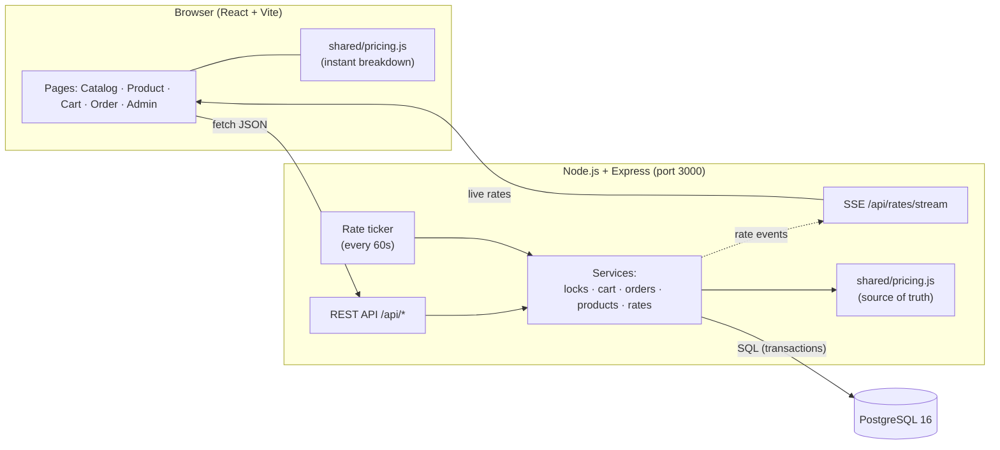
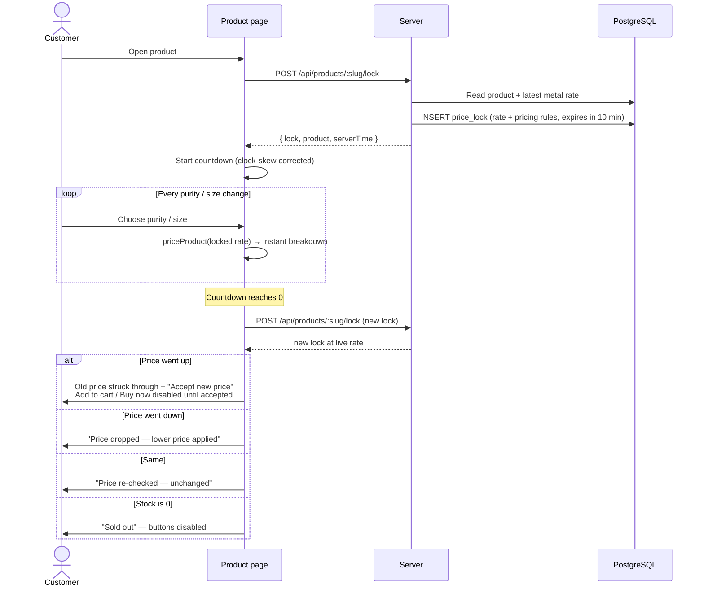
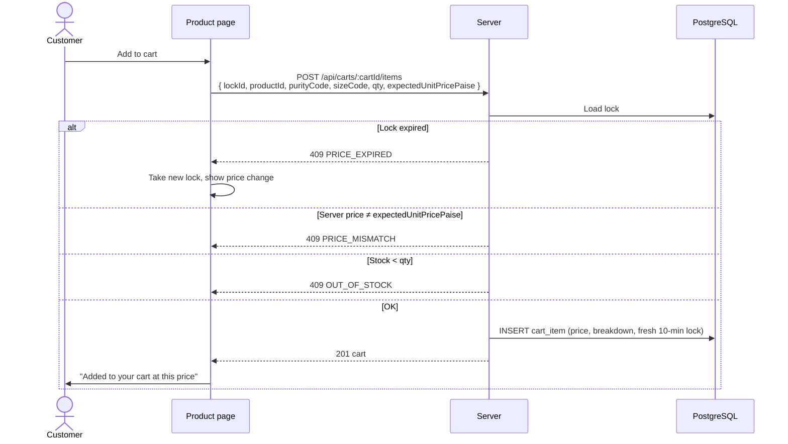
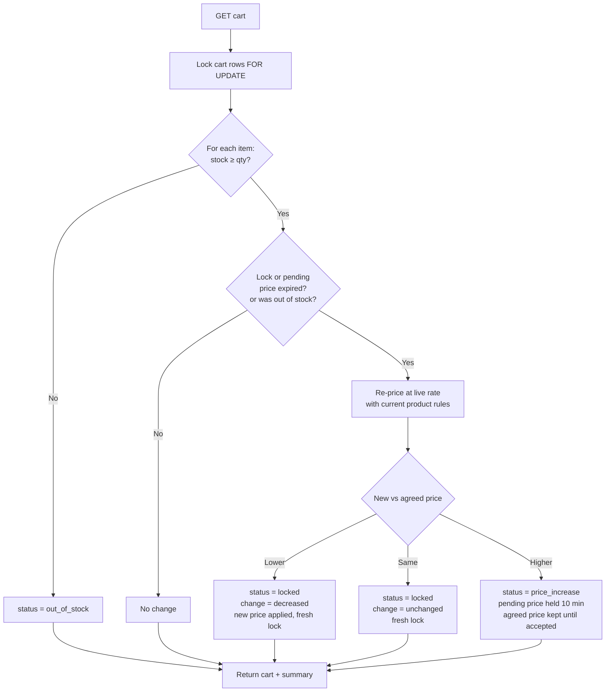
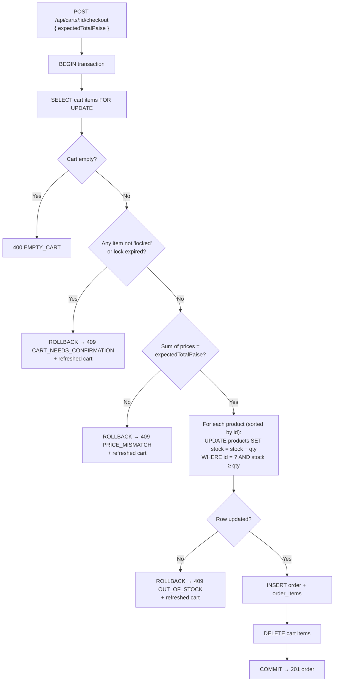
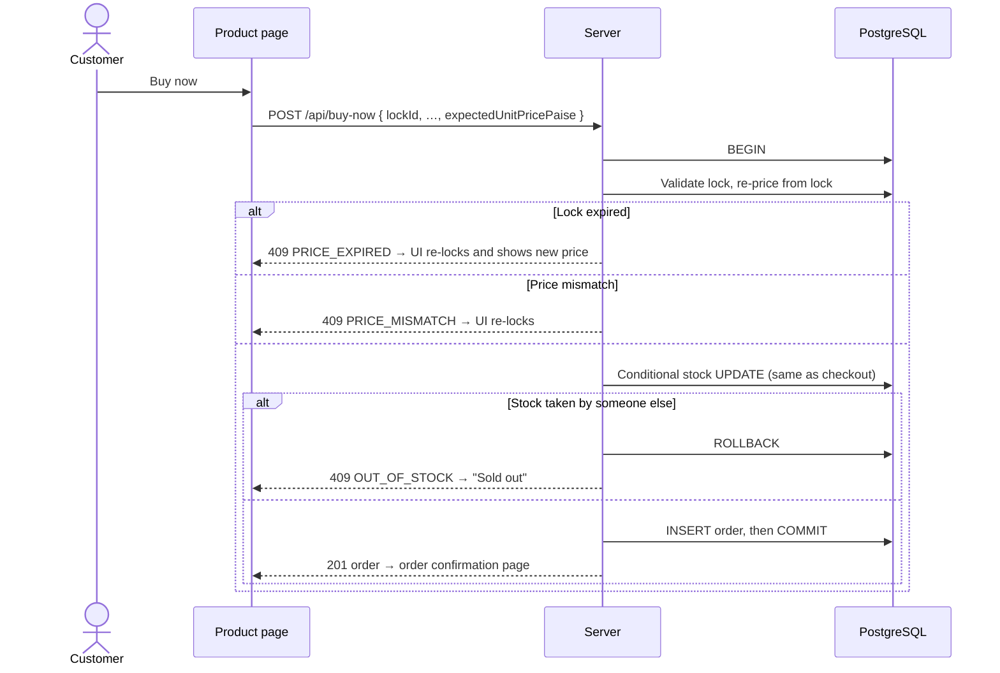
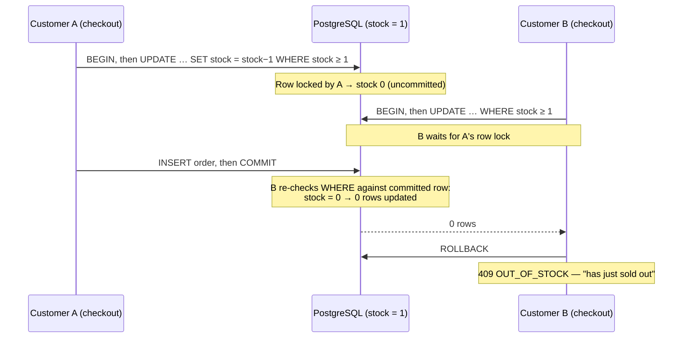
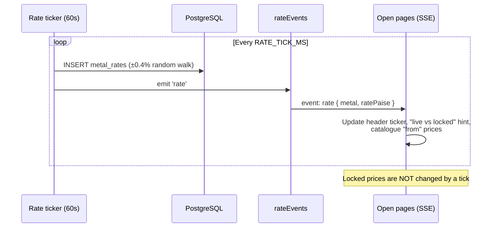
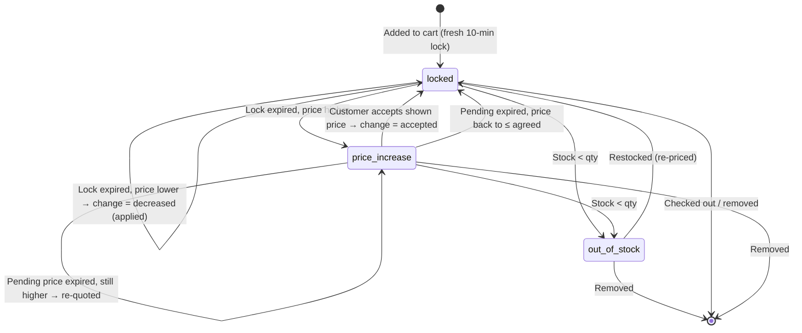
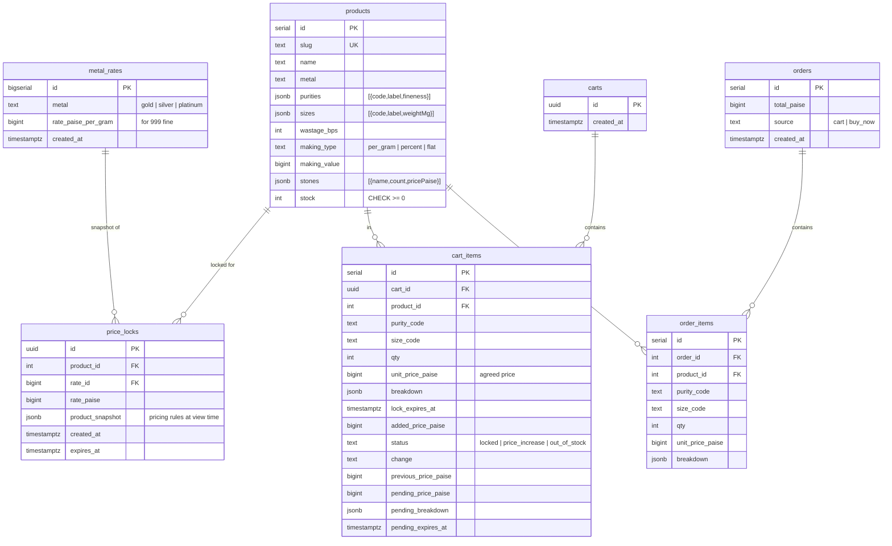

# Technical Documentation

How the Live-Rate Jewellery Configurator works: architecture, flows, data model, and every API endpoint.

**Contents**
1. [Architecture](#1-architecture)
2. [Price calculation](#2-price-calculation)
3. [Flow diagrams](#3-flow-diagrams)
4. [Cart item states](#4-cart-item-states)
5. [Data model](#5-data-model)
6. [API reference](#6-api-reference)
7. [Error codes](#7-error-codes)
8. [Concurrency and safety](#8-concurrency-and-safety)
9. [Front-end](#9-front-end)
10. [Tests](#10-tests)

---

## 1. Architecture



| Layer | Technology | Responsibility |
|---|---|---|
| Client | React 18, React Router, Vite | Configurator, cart, countdowns, live-rate display |
| Shared | Plain JavaScript module | Pricing engine used by **both** client and server |
| Server | Node 22, Express 4, `pg` | API, price locks, re-pricing, checkout, rate ticker, SSE |
| Database | PostgreSQL 16 | Products, rates, locks, carts, orders; row-level locking for safe checkout |
| Packaging | Docker Compose | `db`, `app` and `test` services; one command to run |

**Key design decision:** the same `shared/pricing.js` runs in the browser and on the server. The browser uses it to update the breakdown instantly as the customer changes options. The server uses it to decide what to charge, and **never trusts a price sent by the browser**. The browser's number is only used as a check: if it differs from the server's, the request is refused.

---

## 2. Price calculation

File: [`shared/pricing.js`](../shared/pricing.js)

### Units (all integers, no floating point)

| Quantity | Unit | Example |
|---|---|---|
| Money | paise | ₹12,450.00 → `1245000` |
| Weight | milligrams | 4.200 g → `4200` |
| Percentages | basis points | 10% → `1000`, 3% → `300` |
| Purity | fineness (parts per 1000) | 22K → `916` |

### Formula

```
purityRate   = round( baseRate999 × fineness / 999 )         paise per gram
metal        = round( purityRate × weightMg / 1000 )
wastage      = round( metal × wastageBps / 10000 )
making       = per_gram : round( makingValue × weightMg / 1000 )
               percent  : round( metal × makingValue / 10000 )
               flat     : makingValue
stones       = Σ pricePaise × count
subtotal     = metal + wastage + making + stones
gst          = round( subtotal × 300 / 10000 )
total        = subtotal + gst
```

`round` is half-up to the nearest paisa, done with `BigInt` (`roundDiv`).

### Worked example (seeded Aarna Solitaire Ring, 22K, size 12, gold at ₹12,450/g)

| Line | Working | Amount |
|---|---|---|
| 22K rate | 12,450 × 916 ÷ 999 = 11,415.6156 | ₹11,415.62 /g |
| Metal | 11,415.62 × 4.200 g = 47,945.604 | ₹47,945.60 |
| Wastage | 10% of metal | ₹4,794.56 |
| Making | ₹650 × 4.2 g | ₹2,730.00 |
| Stones | ₹38,500 + 2 × ₹450 | ₹39,400.00 |
| **Subtotal** | | ₹94,870.16 |
| GST | 3% = 2,846.1048 | ₹2,846.10 |
| **Total** | | **₹97,716.26** |

### Exported functions

| Function | Purpose |
|---|---|
| `calculatePrice({ baseRatePaise999, fineness, weightMg, wastageBps, making, stones })` | Core calculation; returns every line |
| `priceProduct(product, { purityCode, sizeCode }, baseRatePaise999)` | Price a product configuration; adds labels for display |
| `purityRatePerGram(baseRate, fineness)` | Rate for a given purity |
| `roundDiv(n, d)` | Half-up integer division |
| `formatINR`, `formatGrams`, `formatBps` | Display helpers |
| `GST_BPS`, `LOCK_MS` | Constants (3%, 10 minutes) |

---

## 3. Flow diagrams

### 3.1 Viewing a product and configuring it



### 3.2 Add to cart



### 3.3 Cart re-pricing after a lock expires

Every `GET /api/carts/:cartId` re-checks each item in one transaction.



### 3.4 Checkout (cart)



### 3.5 Buy now



### 3.6 Two customers, last unit



### 3.7 Live rates



---

## 4. Cart item states



| `status` | Meaning | Can checkout? |
|---|---|---|
| `locked` | Customer has agreed a price; lock running | Yes (if lock not expired) |
| `price_increase` | A higher price is waiting for the customer to accept | No |
| `out_of_stock` | Not enough stock for this item | No |

| `change` (note shown) | Meaning |
|---|---|
| `null` | No re-pricing has happened yet |
| `decreased` | Price fell; lower price applied automatically |
| `unchanged` | Price re-checked; same |
| `increased` | Price rose; awaiting acceptance |
| `accepted` | Customer accepted a higher price |

---

## 5. Data model

File: [`server/src/schema.sql`](../server/src/schema.sql)



Notes:
- The latest row per metal in `metal_rates` is the live rate; history is kept.
- Every order item stores the full breakdown it was sold at.
- The schema is idempotent (`CREATE … IF NOT EXISTS`) and applied on every start. Seed data is inserted only when `products` is empty.

---

## 6. API reference

Base URL: `http://localhost:3000/api` · JSON in, JSON out · all money in **paise**.

### Summary

| Method | Path | Purpose |
|---|---|---|
| GET | `/health` | Health check |
| GET | `/rates` | Current rate for each metal |
| GET | `/rates/stream` | Live rate changes (Server-Sent Events) |
| GET | `/products` | All products, with live "from" price |
| GET | `/products/:idOrSlug` | One product |
| POST | `/products/:idOrSlug/lock` | Take a 10-minute price lock (called when a product is viewed) |
| POST | `/buy-now` | Buy one configuration straight from a lock |
| GET | `/carts/:cartId` | Get cart (re-prices expired items first) |
| POST | `/carts/:cartId/items` | Add an item from a lock |
| DELETE | `/carts/:cartId/items/:itemId` | Remove an item |
| POST | `/carts/:cartId/items/:itemId/accept` | Accept a price increase |
| POST | `/carts/:cartId/checkout` | Place an order for the whole cart |
| GET | `/orders/:id` | Order details |
| PUT | `/admin/rates/:metal` | *(admin)* Set a metal rate |
| PUT | `/admin/products/:id/pricing-rules` | *(admin)* Change wastage / making rules |

---

### GET `/health`
```json
{ "ok": true }
```

### GET `/rates`
```json
{
  "gold":     { "id": 12, "ratePaise": 1245000, "updatedAt": "2026-10-21T11:40:00.000Z" },
  "silver":   { "id": 13, "ratePaise": 15200,   "updatedAt": "…" },
  "platinum": { "id": 14, "ratePaise": 495000,  "updatedAt": "…" }
}
```

### GET `/rates/stream`
`Content-Type: text/event-stream`. One event per rate change; a comment ping every 25 s.
```
event: rate
data: {"metal":"gold","ratePaise":1249980,"id":15,"at":"2026-10-21T11:41:00.000Z"}
```

### GET `/products`
Array of products, each with `fromPricePaise` (cheapest purity at the smallest size, at the live rate).
```json
[{
  "id": 1, "slug": "aarna-solitaire-ring", "name": "Aarna Solitaire Ring",
  "description": "…", "category": "ring", "metal": "gold",
  "purities": [{ "code": "22K", "label": "22K (916)", "fineness": 916 }, { "code": "18K", "label": "18K (750)", "fineness": 750 }],
  "sizes": [{ "code": "10", "label": "Size 10", "weightMg": 3850 }, …],
  "wastageBps": 1000, "makingType": "per_gram", "makingValue": 65000,
  "stones": [{ "name": "Diamond 0.25 ct (VS-GH)", "count": 1, "pricePaise": 3850000 }, …],
  "stock": 3,
  "fromPricePaise": 8393100
}]
```

### GET `/products/:idOrSlug`
Same product shape, without `fromPricePaise`. `404 NOT_FOUND` if missing.

### POST `/products/:idOrSlug/lock`
No body. Returns `201`:
```json
{
  "lock": {
    "id": "91728397-054e-4127-a713-369d390f3fd2",
    "productId": 1,
    "ratePaise": 1245000,
    "product": { "…pricing rules snapshot…" },
    "createdAt": "2026-10-21T11:40:00.000Z",
    "expiresAt": "2026-10-21T11:50:00.000Z"
  },
  "product": { "…live product incl. stock…" },
  "serverTime": "2026-10-21T11:40:00.000Z"
}
```
The client computes the breakdown itself with `priceProduct(lock.product, cfg, lock.ratePaise)`, and uses `serverTime` to correct its countdown for clock skew.

### POST `/buy-now`
```json
{
  "lockId": "91728397-…",
  "productId": 1,
  "purityCode": "22K",
  "sizeCode": "12",
  "qty": 1,
  "expectedUnitPricePaise": 9771626
}
```
`201`:
```json
{ "id": 7, "totalPaise": 9771626, "createdAt": "…", "source": "buy_now" }
```
Errors: `409 PRICE_EXPIRED`, `409 PRICE_MISMATCH`, `409 OUT_OF_STOCK`, `400 BAD_REQUEST`.

### GET `/carts/:cartId`
`cartId` is a UUID generated by the client. An unknown id returns an empty cart. Expired items are re-priced before responding.
```json
{
  "id": "5b3c…",
  "items": [{
    "id": 4,
    "product": { "id": 1, "slug": "aarna-solitaire-ring", "name": "Aarna Solitaire Ring", "metal": "gold", "category": "ring" },
    "stock": 3,
    "purityCode": "18K", "sizeCode": "10",
    "purityLabel": "18K (750)", "sizeLabel": "Size 10",
    "qty": 1,
    "status": "price_increase",
    "change": "increased",
    "addedPricePaise": 8375168,
    "unitPricePaise": 8375168,
    "linePaise": 8375168,
    "breakdown": { "metalPaise": 3582710, "wastagePaise": 358271, "makingPaise": 250250, "stonesPaise": 3940000,
                   "subtotalPaise": 8131231, "gstPaise": 243937, "totalPaise": 8375168, "…": "…" },
    "lockExpiresAt": "…",
    "previousPricePaise": 8375168,
    "pendingPricePaise": 8672328,
    "pendingBreakdown": { "…": "…" },
    "pendingExpiresAt": "…"
  }],
  "summary": {
    "itemCount": 1,
    "confirmedCount": 0,
    "awaitingConfirmationCount": 1,
    "outOfStockCount": 0,
    "totalPaise": 0,
    "totalIfAcceptedPaise": 8672328,
    "canCheckout": false
  },
  "serverTime": "…"
}
```
`summary.totalPaise` counts confirmed items only; `totalIfAcceptedPaise` shows what the total would be if every pending increase were accepted.

### POST `/carts/:cartId/items`
Body is the same as `/buy-now`. Starts a fresh 10-minute lock for the item. Returns `201` with the full cart.
Errors: `409 PRICE_EXPIRED`, `409 PRICE_MISMATCH`, `409 OUT_OF_STOCK`, `400 BAD_REQUEST`.

### DELETE `/carts/:cartId/items/:itemId`
Returns the updated cart.

### POST `/carts/:cartId/items/:itemId/accept`
```json
{ "pendingPricePaise": 8672328 }
```
Must equal the price the customer was shown. Returns the updated cart (item now `locked`, `change: "accepted"`, fresh lock).
Errors: `409 PRICE_CHANGED_AGAIN` (with `cart`) if the pending price was re-quoted in the meantime; `404 NOT_FOUND`.

### POST `/carts/:cartId/checkout`
```json
{ "expectedTotalPaise": 59960960 }
```
`201`:
```json
{ "id": 8, "totalPaise": 59960960, "createdAt": "…", "source": "cart" }
```
Errors (each includes the refreshed `cart`): `409 CART_NEEDS_CONFIRMATION`, `409 PRICE_MISMATCH`, `409 OUT_OF_STOCK`. Also `400 EMPTY_CART`.

### GET `/orders/:id`
```json
{
  "id": 8, "totalPaise": 59960960, "source": "cart", "createdAt": "…",
  "items": [{ "productId": 1, "name": "Aarna Solitaire Ring", "slug": "…", "metal": "gold", "category": "ring",
              "qty": 1, "unitPricePaise": 8672328, "breakdown": { "…": "…" } }]
}
```

### PUT `/admin/rates/:metal` *(admin)*
Header `x-admin-token: <ADMIN_TOKEN>` (default `admin`).
```json
{ "ratePaise": 1300000 }
```
Inserts a new rate and pushes it to all open pages. Returns `{ metal, ratePaise, id, at }`.

### PUT `/admin/products/:id/pricing-rules` *(admin)*
Header `x-admin-token`.
```json
{ "wastageBps": 1000, "makingType": "per_gram", "makingValue": 65000 }
```
`makingValue` is paise per gram (`per_gram`), basis points (`percent`) or paise (`flat`). Applies to new locks and to cart items when re-priced; never to an existing lock. Returns the updated product.

---

## 7. Error codes

All errors share one shape:
```json
{ "error": { "code": "OUT_OF_STOCK", "message": "Sorry, Meher Temple Necklace has just sold out.", "…extra": "…" } }
```

| HTTP | Code | When | Client behaviour |
|---|---|---|---|
| 400 | `BAD_REQUEST` | Invalid input (bad cart id, unknown purity/size, bad qty) | Show message |
| 400 | `EMPTY_CART` | Checkout with no items | Show message |
| 401 | `UNAUTHORISED` | Admin call without valid token | Show message |
| 404 | `NOT_FOUND` | Product, item or order missing | Show message |
| 409 | `PRICE_EXPIRED` | Lock has run out | Take a new lock and show the price change |
| 409 | `PRICE_MISMATCH` | Browser's price/total ≠ server's | Re-lock (product) / show refreshed cart |
| 409 | `OUT_OF_STOCK` | Not enough stock | Mark sold out |
| 409 | `CART_NEEDS_CONFIRMATION` | Checkout with an expired, pending or out-of-stock item | Show refreshed cart with inline messages |
| 409 | `PRICE_CHANGED_AGAIN` | Accept sent for a price that is no longer pending | Show refreshed cart |
| 500 | `INTERNAL` | Unexpected error | Generic message; details in server log |

---

## 8. Concurrency and safety

| Risk | Protection |
|---|---|
| Two buyers, last unit | Single conditional `UPDATE … WHERE stock >= qty`; Postgres row lock makes the second wait and then see 0 rows |
| Stock going negative | `CHECK (stock >= 0)` on `products` as a backstop |
| Deadlock between multi-item carts | Products are decremented in ascending id order |
| Same cart checked out twice (double-click) | `SELECT … FOR UPDATE` on cart rows; second request finds the cart empty |
| Charging a price the customer didn't see | Server re-prices; checkout requires `expectedTotalPaise` to match; accept requires the shown pending price |
| Expired lock at checkout | Checked inside the checkout transaction; refused with the refreshed cart |
| Admin change during a lock | Lock stores a snapshot of the pricing rules |
| Client clock wrong | Countdown uses `serverTime` to correct skew; server is the only judge of expiry |
| Floating-point errors | Integer paise / mg / bps with `BigInt` intermediates |

Isolation level is PostgreSQL's default **READ COMMITTED**, which is sufficient because the stock check and decrement happen in one atomic statement.

---

## 9. Front-end

Files: [`client/src/`](../client/src/)

| File | Role |
|---|---|
| `main.jsx` | App shell, routes, header with cart badge and live-rate ticker |
| `api.js` | Fetch wrapper, `ApiError`, cart id in `localStorage`, clock-skew helper |
| `hooks.js` | `useCountdown`, `useLiveRates` (SSE), cart badge context |
| `components.jsx` | `PriceBreakdown`, `LockTimer`, `JewelArt` (SVG illustrations), `Money` |
| `pages/Catalog.jsx` | Product grid with live "from" prices |
| `pages/Product.jsx` | Configurator, lock + countdown, re-lock on expiry, accept flow, Add to cart / Buy now |
| `pages/Cart.jsx` | Items with own countdowns, inline messages, accept/remove, summary, gated checkout |
| `pages/Order.jsx` | Order confirmation |
| `pages/Admin.jsx` | Set rates; edit wastage/making rules |

Routes: `/`, `/products/:slug`, `/cart`, `/orders/:id`, `/admin`.

Responsive breakpoints: 860 px (stack to single column) and 520 px (phone layout).

---

## 10. Tests

Folder: [`server/test/`](../server/test/) · runner: Node's built-in `node:test` · real PostgreSQL (separate `jewellery_test` database).

| File | Tests | Covers |
|---|---|---|
| `pricing.test.js` | 8 | Hand-calculated prices (gold/silver/platinum, all making types, stones), half-up rounding, breakdown always sums to total |
| `price-lock.test.js` | 6 | 9:59 valid / 10:00 expired; locked price holds when rate or admin rules change; expired Buy-now / Add-to-cart refused and take no stock; mismatched client price refused |
| `concurrent-checkout.test.js` | 5 | Two carts race for last unit (once and 20×); 15 Buy-nows for 3 units; cart vs Buy-now; double-clicked checkout |
| `cart-price-change.test.js` | 10 | Over HTTP: drop applied, unchanged, rise blocks checkout until accepted, stale accept refused, pending re-quoted, out of stock, expired-lock checkout, summary counts |

Time is controlled through an injectable clock (`server/src/clock.js`), so lock expiry is tested instantly without sleeping.
